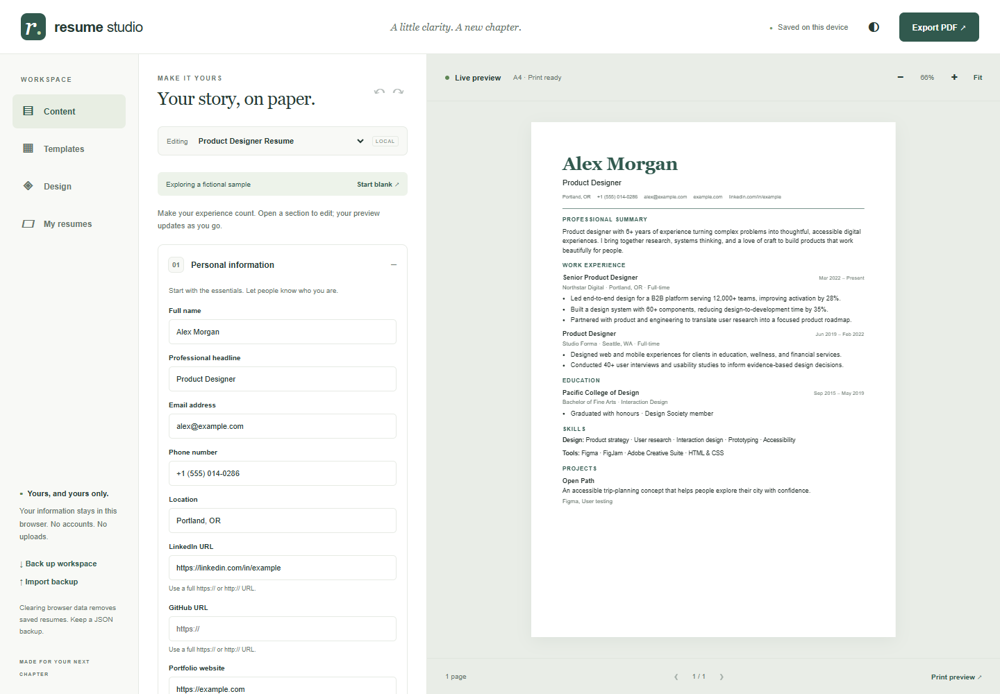
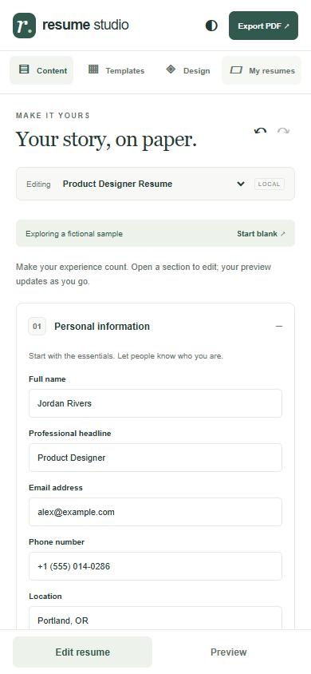
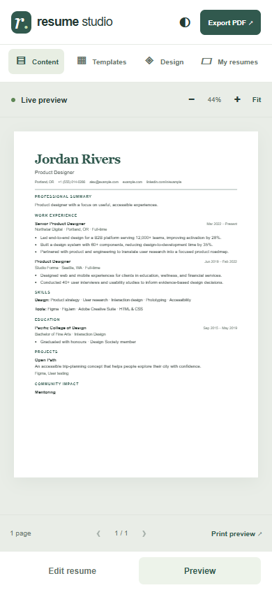
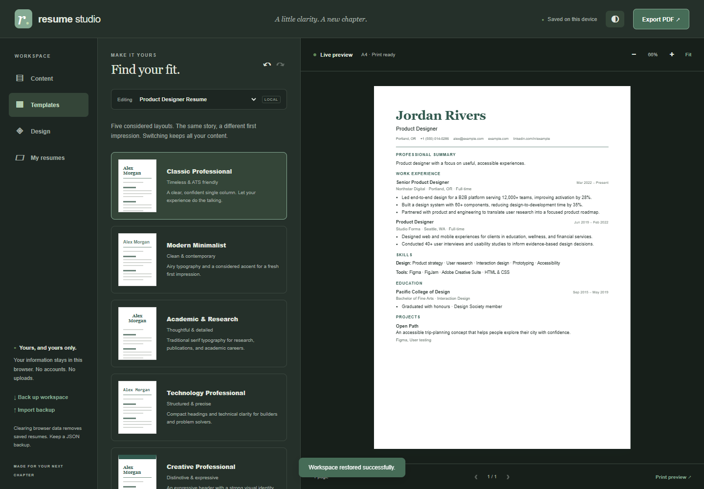

# Resume Studio

A free, private, open-source resume workspace. Tell your professional story through structured forms, tailor it for each opportunity, and print a polished document. No account, backend, paid API, external fonts, or runtime dependencies.

[Open Resume Studio](https://nicholasmile.github.io/resume-studio/) · [Source on GitHub](https://github.com/Nicholasmile/resume-studio)

## Features

- Live A4 or US Letter preview with measured pagination, zoom, and page navigation.
- Personal details and links, multi-paragraph summary, work experience, education, grouped skills, projects, and certifications.
- Publications, research, volunteering, leadership, awards, languages, memberships, references, and a custom section with an editable heading.
- Add, edit, remove, include/exclude, and reorder entries; hide and reorder whole sections.
- Five HTML/CSS templates: Classic Professional, Modern Minimalist, Academic & Research, Technology Professional, and Creative Professional. All use selectable text and the same reading order.
- Font, size, heading style, accent, line spacing, section spacing, margins, date format, and paper controls.
- Master profile plus independent versions: create, duplicate, rename, delete, and select relevant entries. Existing versions do not change when the master is edited.
- Debounced local saving, validated versioned JSON backups and restore, blank resumes, and a clearly marked fictional sample.
- Undo/redo (last 50 snapshots in the current session), confirmation for deletion, reset, and import.
- Responsive editor/preview toggle, keyboard navigation, accessible field names, and light/dark workspace themes. Print colours remain independent of dark mode.
- Offline use after the service worker caches a successful first visit on HTTPS or localhost.
- Browser-native PDF printing, with page sizes, clickable web links, and selectable text.

## Screenshots



<details><summary>Mobile and dark theme</summary>





</details>

## Run locally

Install Node.js 22 or later. No `npm install` is needed for the app or model tests.

```sh
git clone https://github.com/Nicholasmile/resume-studio.git
cd resume-studio
npm start
```

Open the printed URL, normally `http://127.0.0.1:4173`. Set `PORT` if another process uses that port. Any static HTTP server also works. Use HTTP rather than opening `index.html` as a file: ES modules and offline caching require a served origin.

## Usage

1. Explore the fictional Alex Morgan sample, or choose **Start blank** to reset the active resume.
2. Edit **Content**. Open a section, add entries, and write achievements with one bullet per line. Blank fields are omitted from the document.
3. Choose **Templates** and adjust **Design**. Each version retains its own presentation settings.
4. In **My resumes**, open and complete the **Master professional profile**. Create versions from the master for specific opportunities. Use the include checkboxes to select relevant experiences, projects, and skill groups. Versions are snapshots, not synchronized views.
5. Rename a version by editing its name and leaving the field. Duplicate it or create another blank resume when needed.
6. Export **Back up workspace** to preserve the master and all versions in one JSON file. **Import backup** validates the file before asking to replace the workspace. Undo can recover the previous workspace in the same session.
7. Select **Export PDF** or **Print preview**. In your browser's print dialog choose **Save as PDF**, the matching paper size, no additional margins, and turn off browser headers and footers. The document title supplies a descriptive suggested filename; the browser controls the final filename and save location.

Your information stays in your browser's LocalStorage. Clearing site data, changing browsers, or using a different device will not carry it over. Download backups regularly. Offline availability does not protect saved data from deletion. Shared browser profiles can access saved resumes.

## GitHub Pages deployment

1. Create a GitHub repository and push this project to its `main` branch.
2. In **Settings → Pages**, choose **GitHub Actions** as the source.
3. The included `pages.yml` runs model tests, packages only the static app, and deploys it. You can trigger it manually from the Actions tab.
4. Open the URL reported by the deployment. All assets use relative paths, so repository subpaths work.

Alternatively, deploy from the root of the `main` branch using Pages' branch-based publishing. `.nojekyll` is included. No custom domain or paid hosting is required. The public project uses the included GitHub Actions workflow; fork it to publish your own copy.

## Technology and structure

Semantic HTML5, CSS3, native ES modules, LocalStorage, JSON, service worker caching, and browser printing. Node is only a convenience server and test runner.

```text
index.html                   application shell
assets/css/app.css           responsive workspace and themes
assets/css/resume.css        five templates and print rules
assets/js/model.js           schema, defaults, validation, data utilities
assets/js/render.js          safe DOM rendering and measured pagination
assets/js/app.js             forms, history, versions, persistence, events
assets/icons/favicon.svg     local brand icon
manifest.webmanifest         installable application metadata
sw.js                        offline cache
scripts/serve.mjs             dependency-free local server
tests/model.test.mjs          Node data and security tests
tests/browser.mjs             optional Playwright workflow tests
docs/architecture.md          architecture and extension decisions
docs/qa.md                    verification coverage and reproduction
docs/screenshots/             real application screenshots
examples/sample-workspace.json fictional versioned backup
.github/workflows/pages.yml   static GitHub Pages deployment
LICENSE                       MIT license
```

## Testing and contributing

```sh
npm test
```

Optional browser QA requires Playwright and a browser. Install Playwright in your development environment, then run `node tests/browser.mjs` while the server is running. It defaults to installed Microsoft Edge; set `BROWSER_CHANNEL=chrome` for Chrome, `TEST_URL` for another preview URL, and `PLAYWRIGHT_PACKAGE` to an absolute module path if Playwright is provided by another runtime. Browser outputs go to ignored `tests/output/`; documentation screenshots are tracked. See [QA details](docs/qa.md).

Contributions are welcome. Keep runtime dependencies minimal, use `textContent` for user text, validate portable data at the import boundary, and preserve schema compatibility. Explain user-visible changes and verification in your pull request. Check desktop, mobile, all templates, and print output for rendering changes. Bump the service worker cache version when releasing changed assets. Do not commit real personal data or private backups.

## Known limitations

- Browser printing requires the user to choose Save as PDF and appropriate print settings; direct PDF downloads are not used. Browser engines, installed fonts, and print drivers can affect output.
- Ordinary entries stay together when they fit a page. An entry or paragraph larger than an entire page is split into fragments; very large text fragments normalize whitespace at page boundaries. No automatic repeated entry heading is added.
- LocalStorage is per browser/origin and has a finite quota. Saving failures are surfaced; export JSON to retain work. Backups up to 5 MB, 100 versions, and 500 entries per section are accepted.
- Up to 21 custom sections are available, each with multiple generic entries and an editable heading. Additional professional sections use flexible generic fields.
- Undo history is memory-only, and text entry uses the browser's native undo shortcuts inside inputs. Use the toolbar to undo workspace changes. Simultaneous editing in multiple tabs is not synchronized.
- The interface is English-only. No DOCX export, uploaded photos, rich HTML editing, cloud synchronization, job matching, or ATS score is included. Screening systems differ; no template can guarantee acceptance.
- Offline use depends on a completed initial cache and browser support. Service workers require HTTPS or localhost.

## Roadmap

Future work may add schema migrations, richer custom section fields, localization, optional IndexedDB storage, and consent-based AI integrations. Any external AI assistance must explicitly describe what will be shared and obtain consent before transmitting professional information. The app works without AI.

## License

MIT — see [LICENSE](LICENSE). Free to use, modify, and distribute.
